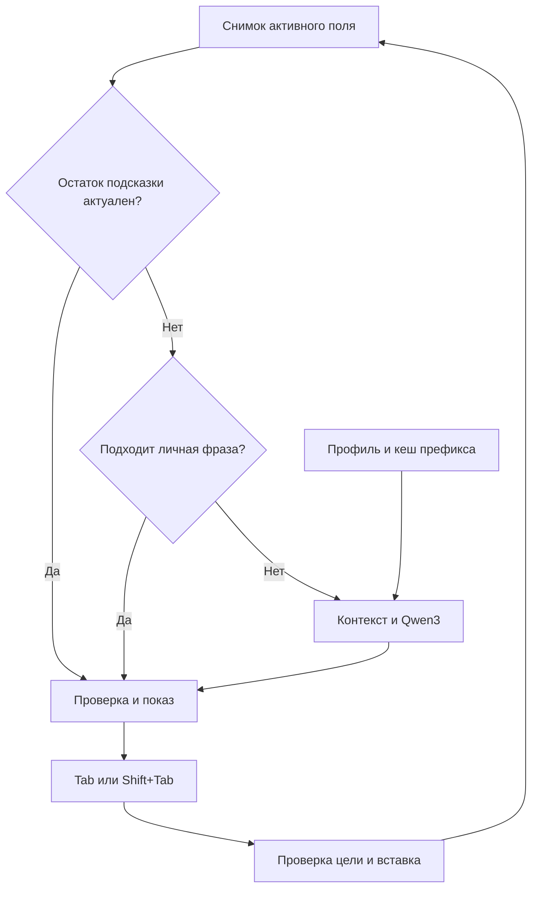

# LocalType — архитектура локального помощника ввода
Версия спецификации: 2.1 · 21 октября 2026

**Статус:** итоговая спецификация архитектуры LocalType. Модель выбрана: **Qwen3-1.7B-Base, MLX 4-bit**. Целевая машина: **Apple M5, 16 ГБ объединённой памяти**. Приложение ещё не реализовано; совместимость и производительность требуют проверки на этой машине. Численные настройки ниже — параметры реализации, не обещания скорости или потребления RAM.

## 1. Цель и границы

Одно нативное приложение в строке меню macOS, которое читает контекст активного разрешённого текстового поля, локально предлагает продолжение и вставляет только подтверждённый фрагмент.

Целевая платформа: Apple Silicon, macOS 14+. Целевая конфигурация — M5 с 16 ГБ объединённой памяти; точная модель Mac и версия macOS фиксируются при первом запуске. Версия ОС для сборки зависит от выбранного Xcode; минимальная ОС запуска не означает, что на ней можно собрать проект. Текущий manifest MLX Swift LM содержит macOS 14 и Swift tools 6.2; зависимости необходимо фиксировать по проверенному релизу, а не по main. [1, 2]

Обязательные интеграции P0: Apple Notes, конкретный установленный клиент Telegram и обычные поля ввода на выбранных сайтах в Orion. Дополнительные интеграции P1: Obsidian, Claude Desktop и чат Antigravity IDE. Здесь Claude означает Desktop, Antigravity — чат для промптов; терминалы и основной редактор кода не входят в первую версию.

Офлайн работает сам помощник после установки весов модели. Он не делает Telegram, Claude или Antigravity автономными: отправка сообщения и запрос к их AI по-прежнему зависят от этих приложений.

Первоначальная проверка — русский, английский и их смешение в одном тексте. Дополнительные языки включаются настройкой после оценки качества; одинаковое качество для всех языков не предполагается.

## 2. Функциональный контракт

| Функция | Поведение |
|---|---|
| Продолжение слова | При незавершённом слове показывается только недостающий суффикс; уже введённые символы не дублируются. |
| Продолжение предложения | Учитываются последние абзацы до курсора. Видимый фрагмент — до 4 слов; дальнейшее продолжение появляется после принятия. |
| Tab | Принимает одно слово, включая завершение уже начатого слова. |
| Shift+Tab | Принимает до 3 слов по умолчанию; настройка позволяет 4, жёсткий максимум — 4. |
| Escape | Убирает активную подсказку до следующего содержательного изменения текста. |
| Персонализация | Личный словарь, повторяющиеся фразы, отдельные стили для приложений и языков, примеры собственных текстов, обратная связь. |
| Управление | Пауза, включение для конкретного приложения, режим без сохранения, удаление памяти, профиль стиля, языки и переназначение клавиш. |

**Пример:** после «Я могу » видны «проверить это завтра утром». Tab вставляет «проверить», Shift+Tab при лимите 3 — «проверить это завтра». Если уже введено «прове», Tab добавляет «рить», и завершение текущего слова считается одним словом.

Правила принятия:

- Слова определяются языковым сегментатором, а не токенами LLM и не простым split по пробелу. Правила для дефисов, апострофов и чисел фиксируются тестами. [7]
- Пробелы и прилегающая пунктуация переносятся вместе с фрагментом без изменения уже написанного.
- Конец предложения может завершить фрагмент раньше установленного лимита.
- Перенос строки, Enter, управляющие символы и отправка сообщения никогда не генерируются как действия.
- Когда подсказки нет, Tab и Shift+Tab проходят в приложение как обычно. При конфликте пользователь может переназначить комбинации для приложения.
- При непустом выделении текста автодополнение отключается.
- Уже показанные слова не переписываются внезапно: допустимо дописать хвост, но смена кандидата требует нового ввода либо явного отклонения.

Проверка и исправление опечаток исключены из объёма проекта. Помощник только дописывает текст по подтверждению пользователя и не изменяет уже введённые символы. Личный словарь сохраняется для персонализации продолжений.

## 3. Технологический стек

| Слой | Выбор | Зачем |
|---|---|---|
| Язык | Swift 6; Swift Package Manager | Нативные системные API и единый язык продукта |
| Интерфейс | SwiftUI для настроек; AppKit для меню и NSPanel | Управление окном подсказки без захвата фокуса |
| Чтение редактора | ApplicationServices: AXUIElement, AXObserver | Контекст, выделение, положение курсора, изменения поля |
| Клавиатура | CoreGraphics CGEventTap; проверенный адаптер вставки | Tab/Shift+Tab и ввод принятого фрагмента |
| Инференс | MLX Swift LM / MLX на Metal | Локальная небольшая языковая модель |
| Язык и слова | NaturalLanguage: NLLanguageRecognizer, NLTokenizer | Выбор языка и границы слов |
| Хранение | GRDB.swift поверх SQLite; WAL | Миграции, транзакции и зашифрованные записи; операции вне потока ввода |
| Быстрые личные подсказки | N-граммы + префиксное дерево в RAM | Повторяющиеся обороты без запуска модели |
| Защита памяти | CryptoKit AES-GCM; ключ в Keychain | Защита сохранённых личных текстов |
| Проверка | XCTest, локальный тестовый редактор, Instruments | Контракты, реальные интеграции, задержки и память |
| Доставка | .app/.dmg; для распространения Developer ID и notarization | Установка вне App Store [17] |

Apple документирует AXUIElement, уведомления Accessibility, event taps и NaturalLanguage. Это примитивы реализации, а не гарантия поддержки любого редактора. [3, 4, 5, 6, 7, 8]

**Основная конструкция — модульный монолит:** один процесс, пять подсистем и одна активная генерация. Фоновое приложение в строке меню использует LSUIElement. Backend, аккаунт, облачная БД и постоянно работающий Python-сервер не нужны. Python допустим как отдельный инструмент экспериментов/дообучения, но не зависимость установленного приложения.

Выбран один runtime: MLX Swift LM. Интерфейс CompletionEngine сохраняет возможность замены движка, но llama.cpp и вторая модель не поставляются параллельно. LoRA не требуется для первой версии. [1]

Для работы с SQLite используется GRDB.swift: она уменьшает объём собственного кода хранения. Хранилище использует миграции и транзакции, а чувствительные данные шифруются до записи. WAL не является механизмом шифрования. [14] SwiftUI остаётся для настроек; точный контроль NSPanel обеспечивается AppKit.

## 4. Пять подсистем и маршрут подсказки

| Подсистема | Компоненты и ответственность |
|---|---|
| 1. Input & Session | FocusMonitor, KeyboardRouter, SessionCoordinator, SuggestionBuffer: фокус, события, ревизии текста, конечный автомат, остаток подсказки |
| 2. App Integration | AdapterRegistry, AXBridge, AppAdapter: возможности конкретного поля, чтение, координаты, вставка и проверка результата |
| 3. Completion Pipeline | PersonalPhraseIndex, ContextBuilder, CompletionEngine, SuggestionPolicy, ModelManager: личные фразы, контекст, модель, кеши и ограничения вывода |
| 4. Presentation & Apply | OverlayController, InsertionController: показ, допустимость принятия, повторная проверка цели, управление вставкой через адаптер |
| 5. Personalization & Storage | ProfileStore, FeedbackCollector, LexiconStore, encrypted SQLite: примеры, происхождение текста, статистика, профили, удаление |

AppShell объединяет настройки и разрешения; Diagnostics получает только числовые метрики и коды ошибок. Это внутренние границы одного приложения, не пять процессов или сервисов.

Первые два пути не запускают генерацию LLM. Если личная фраза уже показана, модель не заменяет её самопроизвольно. Дополнительная модель для черновика и каскад из двух LLM не нужны.

UI работает на MainActor. AX обслуживается отдельной последовательной очередью/run loop с ограниченными таймаутами. Модель и БД изолированы actors. Один InferenceActor владеет моделью и изменяемыми KV-кешами. KeyboardRouter читает только короткое локальное состояние принятия: в callback запрещены AX, БД и ожидание генерации.

## 5. Поток работы, буфер и состояния

1. При фокусе на поле адаптер проверяет разрешения, редактируемость, тип поля и доступные операции. Сессия получает fieldID и revision.
2. Новое событие ввода сразу снимает разрешение на принятие прежнего snapshot. AX-проверка определяет, что реально изменилось; по одному событию клавиатуры нельзя надёжно восстановить текст.
3. Если пользователь допечатал точный префикс показанной фразы в том же поле и позиции, SuggestionBuffer убирает этот префикс. После проверки нового snapshot и обновления панели остаток снова доступен без LLM. Несовпадение, Backspace, движение курсора или внешняя правка сбрасывают буфер.
4. Когда подходящего остатка нет, после небольшой настраиваемой паузы снимается новый snapshot. Стартовый debounce — около 150 мс; это настройка поведения, не целевая задержка готовой подсказки. AX-уведомления объединяются; постоянно опрашивать все приложения не нужно.
5. PersonalPhraseIndex ищет совместимое продолжение по последним словам и частичному слову. Учитываются язык, профиль, происхождение, частота и неоднозначность. При достаточно надёжном кандидате модель не вызывается.
6. Иначе ContextBuilder готовит текущий текст с фиксированными примерами стиля. CompletionEngine выполняет локальную генерацию. Показываются только завершённые допустимые слова, максимум четыре.
7. Tab выбирает одно слово; Shift+Tab — до трёх, либо четырёх по настройке. InsertionController повторно проверяет цель, вставляет фрагмент через адаптер и подтверждает результат чтением поля.
8. После успешной вставки оставшаяся фраза привязывается к новой проверенной ревизии и показывается без новой генерации. При неясном результате буфер удаляется. Когда он исчерпан, новое продолжение строится по актуальному тексту.
9. Обратная связь обновляет ранжирование. Сохранение текста зависит от режима памяти и его происхождения.

Буфер хранит исходную строку, диапазоны слов, уже потреблённый префикс и отпечаток исходного контекста. Простого массива слов недостаточно: нужно сохранить пробелы, знаки препинания и Unicode. Пример: «проверить это завтра утром» после Tab превращается в остаток «это завтра утром», привязанный к подтверждённой позиции после «проверить ».

| Состояние | Поведение клавиш и вычислений |
|---|---|
| Disabled / Paused / Faulted | Обычный ввод; генерация и принятие выключены |
| Observing / Debouncing | Сбор актуального состояния; Tab и Shift+Tab проходят в приложение |
| Generating | Выполняется один запрос; без видимой подсказки клавиши проходят |
| Suggesting | Панель уже показана для текущей ревизии; разрешено принятие |
| Applying | Принятие повторно недоступно до проверки результата вставки |

Смена поля/окна, непустое выделение, активная или непроверенная композиция ввода, потеря разрешения и ошибка AX немедленно снимают принятие. Escape скрывает подсказку до следующего содержательного изменения текста. Смена профиля отменяет запрос и сбрасывает его буфер.

Очередь работает по принципу «последний запрос побеждает»: одна модель, одна генерация, один ожидающий актуальный запрос. Отмена проверяется между шагами вычисления; устаревшие пакеты requestID не попадают в UI. Уже отправленную GPU-операцию не считать мгновенно прерываемой — следующую генерацию нельзя бесконтрольно запускать поверх неё.

## 6. Контракты данных и адаптеров

Описания ниже — интерфейсы архитектуры, не готовый SDK.

| Контракт | Основные поля |
|---|---|
| FieldIdentity | pid, bundleID, идентичность AX-элемента, window/session ID |
| TextSnapshot | fieldID, revision, captureTime, beforeCaret, afterCaret, selectionUTF16, caretRect?, language, compositionState |
| CompletionRequest | requestID, fieldID, snapshotRevision, profileID/profileVersion, modelRevision, contextTokenIDs, wordLimit |
| Suggestion | id, source: buffer/phrase/model, requestID?, fieldID, revision, profileVersion, displayText, insertionOffsetUTF16, wordSpans, expectedContextFingerprint |
| PrefixCacheKey | model/tokenizer revision, quantization, adapterID/version, profileID/version, language, promptFormatVersion, exact prefix token IDs |
| ApplyResult | verified / rejectedStale / unsupported / uncertain / failed; новая ревизия при успехе |
| AdapterCapabilities | canReadContext, canReadSelection, canLocateCaret, canInsert, undoVerified, compositionObservable |

AppAdapter предоставляет probeCapabilities, readSnapshot, observeChanges, applyInsertion и verifyInsertion.

Не использовать строковую длину Swift как NSRange: индексы AX обычно выражаются в UTF-16. Преобразования проверять на кириллице, диакритике, комбинируемых символах и emoji. Идентификатор AX-элемента не считать долговечным после смены окна.

В первой версии дополнять текст в конце поля или в конце абзаца, если справа только его граница, без непустого выделения. Незавершённое слово в конце дополнять можно. Внутри слова или перед уже существующими словами продолжение отключено: поддержки Fill-in-the-Middle (FIM) в v1 нет. afterCaret читается для проверки границы и актуальности, а не передаётся модели в выдуманном FIM-формате.

CompositionState имеет три значения: active, inactive, unknown. Нельзя предполагать наличие универсального публичного API для состояния чужого IME. При active — пауза; при unknown для непроверенного метода ввода — отключить автоматическое принятие. Проверенные обычные раскладки и dead keys входят в отдельную матрицу тестирования.

## 7. Интеграция с приложениями

| Приложение / поверхность | Приоритет | Подход и ограничения |
|---|---|---|
| Apple Notes, обычный текст | P0 | AX-адаптер; отдельно проверить списки, заголовки, форматирование, Undo |
| Установленный Telegram, поле сообщения | P0 | Отдельный профиль клиента; проверить редактирование сообщения, ответы, переключение чатов |
| Orion, выбранные обычные поля сайтов | P0 | Сначала AX; поддержка по полям/сайтам, а не обещание для всех страниц |
| Obsidian, редактор заметки | P1 | Сначала AX-адаптер для Source mode; отдельно проверить Live Preview, Markdown, списки, Tab/Shift+Tab и Undo; Reading view исключён |
| Claude Desktop, поле промпта | P1 | AX-проба конкретной версии; не предполагать устройство редактора |
| Antigravity IDE, чат | P1 | Адаптер только поля промпта; не смешивать с редактором кода и терминалом |

У Telegram есть разные реализации для macOS, включая Swift-клиент и Telegram Desktop на Qt. Адаптеры выбираются по реальному bundleID и возможностям, а не только по названию приложения. [10, 11]

Apple Notes перечислен у Cotypist как поддерживаемый, но это лишь свидетельство реализуемости, не тест нашего приложения. Telegram, Obsidian, Orion, Claude Desktop и Antigravity не получают статус «поддерживается» до локального прогона. Cotypist также прямо связывает совместимость с доступностью текста через Accessibility. [9]

Obsidian имеет режимы редактирования Source mode и Live Preview. Их проверять раздельно: визуальное скрытие Markdown и изменение представления при движении курсора могут влиять на координаты и диапазоны. На P1 подтверждается совместимость конкретной версии; автоматическое чтение всего vault не предусматривается. Если AX-интеграция не проходит проверку, отдельный плагин Obsidian рассматривается как расширение объёма, а не обязательная часть P1. [18]

Для каждого адаптера фиксировать конкретные appVersion, macOSVersion, тип поля и результаты проверки. Уровни:

- **Полный:** контекст, курсор, вставка и Undo прошли тест.
- **Ограниченный:** дополнение доступно, но подсказка показывается у границы поля из-за отсутствия надёжных координат курсора.
- **Недоступный:** нельзя надёжно прочитать или изменить поле — помощник сообщает об этом и не угадывает.

Для проверенных Electron-приложений адаптер может включить дерево доступности через AXManualAccessibility=true на корневом AX-элементе приложения. Этот механизм документирован Electron, но не гарантирует корректные диапазоны, координаты и вставку в конкретном редакторе. Не устанавливать атрибут всем приложениям и не делать это на каждом нажатии; после включения выполнить повторную пробу. [19]

В Antigravity одного AXRole недостаточно: разрешать только распознанное поле чата с проверенным положением в дереве элементов. Неизвестные поля, основной редактор кода и терминал исключать. Приоритеты P0/P1 отражают нужность приложения пользователю, а не предполагаемую простоту интеграции.

Если AX не отдаёт позицию курсора, но позволяет надёжно читать и вставлять, показывать карточку у границы поля. Если отсутствует безопасная вставка, карточка не делает интеграцию полноценной.

Расширение Orion с content script — отдельная альтернативная ветка, если AX не подходит. Это увеличивает объём: DOM-адаптеры, канал к нативному процессу, проверка разрешений и origin. Нельзя считать поддержку расширений гарантией: Kagi отмечает экспериментальность и неполное покрытие API. [12] Не закладывать localhost-сервер и широкие разрешения заранее.

## 8. Показ подсказки и вставка

**Рекомендуемый v1:** компактный NSPanel рядом с курсором, не забирающий фокус. Пользователь видит текст и подсказки «Tab — слово», «⇧Tab — 3 слова». Поддержать светлую/тёмную тему, несколько мониторов и изменение масштаба.

| Вариант UI | Выгода | Цена |
|---|---|---|
| Карточка рядом с курсором | Проще позиционирование и совместимость | Менее похожа на встроенный текст |
| Точное inline-наложение | Ближе к Cotypist | Метрики шрифта, переносы, масштаб и прокрутка каждого редактора |

Inline-режим можно добавить для отдельных проверенных полей позже; API OverlayController допускает оба режима. Внешняя панель не раздвигает текст чужого документа: inline допустим только при подтверждённой геометрии и свободном месте. Пробел справа сам по себе этого не гарантирует. Карточка размещается по caret/field bounds и границам экрана, а не фиксированным отступом в пикселях. При прокрутке и изменении масштаба позиция пересчитывается, при неизвестной геометрии панель скрывается. Инъекция кода и изменение SIP не нужны.

Вставка:

1. Проверить, что активны прежние приложение и поле, текст/выделение совпадают с snapshot.
2. Проверить пустое выделение, insertionOffsetUTF16 и отпечаток окружающего текста; адаптер должен поддерживать вставку в эту позицию.
3. Вставить только принятый фрагмент в позицию курсора: проверенной AX-операцией либо протестированным Unicode-вводом. CoreGraphics предоставляет Unicode-события, но корректность их обработки зависит от приложения. [5]
4. Перечитать поле и подтвердить ожидаемое изменение. При неясном результате остановиться, а не повторять вставку вслепую.
5. Не заменять целиком AXValue документа: это может нарушить форматирование, Undo и параллельные изменения.
6. Не применять общий алгоритм «несколько Backspace»: число событий не равно числу Unicode-символов.
7. Буфер обмена не использовать в обычном пути. Отдельный совместимый режим возможен только после проверки его конфликтов и явного включения.

**Ограничение платформы:** между проверкой фокуса и внешней вставкой нет общей атомарной транзакции. Версии snapshot снижают риск, но не дают абсолютной гарантии. Необходимо минимизировать промежуток, инвалидировать подсказку по любому изменению и отключать адаптер, если он не проходит проверки гонок.

CGEventTap работает по свежему локальному состоянию «подсказку можно принять», не блокируя поток ввода. Tab может быть подавлен только для видимой активной подсказки. После повторной проверки устаревшая операция отменяется. Редкий Tab, отменённый в этой гонке, не воспроизводить автоматически в другом поле. При отсутствии активной подсказки комбинация проходит без изменений.

Нельзя полностью гарантировать единый Undo для всех AX-операций; это отдельный критерий включения адаптера. Если вставка и Undo ненадёжны, адаптер отключается; собственный небезопасный откат не используется.

## 9. Выбранная модель, кеши и M5 с 16 ГБ

**Зафиксирована Qwen3-1.7B-Base в MLX 4-bit.** Это pretrained causal language model с 1,7 млрд параметров; исходная модель опубликована под Apache 2.0. [13] Используется именно Base, а не Qwen3-1.7B с диалоговой настройкой.

ModelManager принимает MLX-пакет, полученный из официальных исходных весов либо из проверенной конверсии. Manifest фиксирует исходную и производную revision, tokenizer/config, способ 4-битной квантизации и group size, SHA-256 файлов, лицензию и совместимый релиз MLX Swift LM. «4-bit» не означает совместимость с GGUF Q4_K_M. Конкретный пакет должен пройти загрузку и генерацию на закреплённой версии Swift runtime; подмена Base другой моделью недопустима.

Однократная загрузка выполняется при настройке; возможен импорт локального пакета. После установки путь инференса использует только локальные файлы и не обращается к сети. Веса модели загружаются один раз на рабочую сессию, а не на каждое поле.

### Формат входа и короткая генерация

Base-модель продолжает последовательность; архитектура не полагается на исполнение system prompt. PromptBuilder соединяет небольшой постоянный блок одобренных примеров стиля, стабильный разделитель и текущий текст до точки продолжения. Финальный блок остаётся незавершённым текстом пользователя, без просьбы «ответить». Формат разделителей проверяется на задаче; служебные разделители и заголовки из вывода не показываются. Если примеры ухудшают продолжения, допускается профиль без них.

Стартовые настройки:

- Общий входной бюджет — до 2 048 токенов; при сокращении приоритет у текущего контекста.
- Примерно 1 024–1 536 токенов ближайшего текста и 2–4 коротких примера в оставшемся бюджете; точное распределение зависит от доступного текста.
- До 24–32 выходных токенов как защитный лимит; пользователь видит и принимает не более четырёх слов.
- Слова определяются NLTokenizer. Если лимит токенов оборвал последнее слово, показывается только подтверждённая завершённая часть. Для последнего слова нужна наблюдаемая граница или корректный конец генерации.
- Остановка на переводе строки, EOS, служебном разделителе или достаточном числе слов. Пунктуацию учитывать после декодирования; не считать каждую точку отдельной командой остановки, ломая сокращения и числа.
- Начальный режим декодирования — детерминированный; ограниченный sampling добавляется только если сравнительная оценка покажет выигрыш. Версия пресета сохраняется с результатами проверки.

Четыре слова не равны четырём или восьми токенам. Русские слова, имена, сленг и смешанный текст проверяются фактическим tokenizer выбранного пакета. Для незавершённого слова генерация может начинаться от предыдущей границы слова: кандидат обязан буквально продолжать введённый префикс, а вставляется только недостающий суффикс. При несовпадении подсказка отбрасывается без замены пользовательского текста.

### Три разных кеша

| Кеш | Содержимое | Правила использования |
|---|---|---|
| SuggestionBuffer | Уже полученная строка продолжения | Повторное принятие или совпадающий ручной ввод; только после проверки новой ревизии |
| StylePrefixCache | Состояние модели после стабильных примеров профиля | Один активный профиль и ограниченный LRU резервных кешей; без текста текущего документа |
| SessionKVCache | Состояние текущего запроса и его токены | Только для той же сессии и реально совпадающего токенного префикса; очищается при завершении сессии |

Подбор примеров выполняется при выборе профиля/языка или значимой смене темы, вне обработчика клавиатуры. Набор фиксируется на эпоху профиля. Изменение примеров создаёт новую profileVersion и новый кеш; оно не должно менять уже показанную подсказку. В первой реализации достаточно ручного профиля и простого лексического отбора. Векторный поиск на каждое нажатие не нужен.

Кешируется только неизменная часть prompt. Новый текст всё равно требует обработки моделью. Перед переиспользованием сравниваются реальные token IDs: токенизация склеенной строки может изменить пограничный токен. Рабочий запрос получает независимое состояние кеша; нельзя дописывать текущий документ в общий кеш стиля. Поддержку копирования и ограничения KVCache проверить в выбранном релизе. [20]

Смена модели, tokenizer, квантизации, LoRA-адаптера, формата prompt или версии профиля инвалидирует соответствующий кеш. Непринятые сгенерированные токены не считаются пользовательским контекстом. Переключение профиля и попадание в кеш не означают нулевого времени подготовки.

### Политика ресурсов

MLX выполняет модельные вычисления через GPU/Metal, CPU обслуживает ввод, токенизацию и управление. [1] 16 ГБ делят macOS, GPU и остальные приложения. Размер файла весов не равен RAM всего процесса: дополнительно нужны KV-кеши, буферы runtime, UI и личный индекс.

- Одновременно резидентна одна модель; один запрос обрабатывается, остальные заменяются последним актуальным.
- Ограничиваются суммарный размер кешей, длина контекста и объём личного индекса. На старте сохраняется кеш активного стиля; резервные профили добавляются лишь в пределах измеренного бюджета.
- При memory pressure сначала удаляются неактивные кеши и перестраиваемые индексы, затем уменьшается контекст. При сохраняющемся давлении генерация ставится на паузу и модель освобождается безопасно после завершения текущей операции.
- При длительном простое модель может выгружаться; следующий запуск тогда холодный. Настройка «держать готовой» учитывает расход памяти.
- При блокировке удаляются рабочие тексты, подсказки и персональные кеши; дальнейшее чтение полей прекращается. Снижение фоновой активности и частоты предложений используется при энергосбережении/перегреве.
- LoRA-обучение не работает одновременно с подсказками и не запускается автоматически в MVP.

Публичный результат на M5 с 32 ГБ не является результатом на машине пользователя с 16 ГБ. Ранее приведённые показатели других вариантов модели и Python runtime не переносятся на выбранную Base/MLX Swift сборку. Достаточность памяти, задержки и энергопотребление проверяются вместе с обычными приложениями пользователя; непроверенные численные обещания не включаются в требования.

## 10. Персонализация без постоянного дообучения

| Механизм | Решение и этап |
|---|---|
| Личный словарь и частые обороты | Первая версия: имена, термины, N-граммы, префиксный поиск и ранжирование |
| Профили стиля | Первая полноценная версия: chat, notes, technical/prompts; профиль по приложению и языку, ручное переключение |
| Примеры в prompt | Малый набор одобренных текстов, фиксированный на эпоху профиля и совместимый с кешированием |
| Обратная связь | Принятия, отклонения, быстрые отмены и повторяемость; сигнал для ранжирования, не доказательство авторства |
| Logit bias | Эксперимент после MVP; выключен по умолчанию до проверки качества |
| LoRA | Последующий этап при наличии качественного корпуса и доказанной пользы |

### Личные фразы как первый источник

PersonalPhraseIndex хранит словесные N-граммы и префиксное дерево собственных выражений. Выбирает продолжение по нескольким последним словам и введённой части текущего слова. Частота сама по себе недостаточна: учитываются язык, профиль, подтверждение пользователем, давность, отрицательная обратная связь и конкурирующие продолжения. При неоднозначности запрос передаётся модели либо подсказка не показывается.

Порог выбора настраивается на отложенных примерах; не объявлять его «90% уверенности» без калибровки. Индекс обновляется асинхронно после подтверждённого сохранения данных. На диске лежат зашифрованные записи; дерево восстанавливается в RAM. Нужен единый источник данных для индекса и примеров, чтобы удаление записи удаляло её производные представления.

### Источники и границы памяти

- Ручной словарь и команда «Добавить этот текст в мой стиль».
- Импорт выбранных TXT/Markdown и собственных примеров, включая явно выбранные заметки Obsidian.
- Опциональное сохранение собственного ввода в разрешённых приложениях.
- Принятия/отклонения как статистика полезности отдельно от корпуса собственного стиля.

AX-снимок не доказывает авторство. Вставленный, ранее существовавший и неизвестного происхождения текст исключается из автоматического корпуса. Принятый AI-текст помечается отдельно и не обучает стиль автоматически: иначе модель усиливает собственные привычки. Enter и очистка поля не доказывают отправку сообщения. Чужие сообщения и весь vault Obsidian автоматически не читаются.

Лексический отбор примеров выполняется по профилю, языку, тематическим словам, давности и одобрению. Повторять его на каждом символе не нужно. Изменившийся хвост prompt не обязательно отменяет кеш его неизменного начала; поэтому retrieval совместим с кешированием при правильном устройстве префикса. Embeddings рассматриваются только при доказанном ухудшении поиска на выросшем корпусе.

Приоритеты: ручной профиль и запреты → текущий контекст → одобренные примеры → общие закономерности модели. Примеры — данные, не команды приложению; модель не получает инструменты, сетевой доступ или право менять настройки.

### Ограниченное усиление личной лексики

MLX Swift LM имеет интерфейс LogitProcessor, позволяющий менять распределение следующего токена. [21] Это техническая возможность, а не готовая персонализация. Слово может состоять из нескольких токенов, которые встречаются и в других словах; постоянная прибавка всем частым token IDs способна ухудшить грамматику и вызвать повторы.

Если этот механизм понадобится, использовать только небольшой набор контекстно подходящих слов/фраз с учётом их токенных последовательностей и границ. Величина усиления ограничена и подбирается на отдельной выборке; без фиксированного универсального «+1,2…+2,5». В MVP персонализация обеспечивается личными фразами, примерами и ранжированием без такого вмешательства.

### Дообучение после MVP

LoRA запускается вручную либо по явно включённому расписанию простоя при питании от сети. Обучающий корпус проходит фильтрацию и отделяется от проверки по документам/датам. Во время обучения генерация выключена; возможность обучения выбранного пакета и его пик памяти сначала проверяются на M5 с 16 ГБ. Если ресурсов не хватает, приложение сохраняет персонализацию без LoRA.

Кандидат не подменяет рабочий адаптер автоматически. Сначала сравнение с базовой версией, проверка регрессий и выбор пользователя; затем активация вне текущей сессии и сброс кешей. Хранится возможность отката. Продолжительность обучения определяется измерением на выбранной конфигурации. Удаление исходного образца не удаляет влияние из обученных весов — затронутый адаптер отключается и удаляется либо переобучается.

## 11. Хранение и приватность

Файлы приложения: ~/Library/Application Support/LocalType/. Это папка macOS, не облачное хранилище.

| Данные | Хранение |
|---|---|
| Настройки приложения | UserDefaults, без содержимого текстов |
| app_rules / profiles | SQLite; чувствительные текстовые поля шифруются |
| lexicon / phrases | Зашифрованные записи: язык, профиль, происхождение, статистика |
| samples | Зашифрованные тексты, sourceID, consent, origin, retention |
| feedback | Метрики и идентификаторы; текст не нужен по умолчанию |
| models / adapters | Локальные файлы и manifest; личные LoRA-адаптеры считаются чувствительными |
| текущий текст / snapshot / SessionKVCache | Только RAM; очищаются при завершении сессии, смене поля и блокировке |
| StylePrefixCache / личный индекс | Только RAM, ограниченный объём; инвалидируются при изменении профиля/данных, очищаются при блокировке |
| диагностика | Ошибки, длительности, версии; без текстов, названий документов и содержимого чатов |

Режимы памяти:

- **Без сохранения:** текущий контекст и импортированный профиль, без накопления нового текста.
- **Одобренные примеры:** только вручную выбранные материалы.
- **Адаптивный:** явное согласие на сохранение пригодного собственного ввода по приложениям; предложенный срок — 30 дней, настраивается.

GRDB и SQLite сами по себе не шифруют данные. Чувствительные записи хранить как AES-GCM BLOB с уникальными nonce, ключом в Keychain и аутентификацией идентификатора/версии записи. Не создавать незашифрованный FTS-индекс, WAL с plaintext или текстовые debug-логи. Поисковый индекс восстанавливать в оперативной памяти. [15] Метаданные SQLite, не содержащие текста, могут оставаться открытыми: это шифрование содержимого записей, а не всего файла БД. Записи feedback связывать с исходниками по непрозрачным ID.

Ограничить чтение активным разрешённым полем. Предпочитать чтение диапазона; если доступен только полный AXValue, обрабатывать его временно, обрезать и не сохранять весь документ. Для слишком больших/непонятных полей отключать автодополнение. Парольные поля, известные поля токенов, терминалы и неизвестные типы по умолчанию исключены. Эвристики поиска секретов — дополнительный фильтр, не гарантия.

Accessibility — обязательное разрешение. Input Monitoring запрашивается только если выбранный путь наблюдения клавиш действительно его требует; проверять доступность во время работы. Screen Recording для этой архитектуры не нужен: OCR отсутствует. Отказ/отзыв разрешения приводит к понятному неактивному состоянию. [3, 4, 16]

Шифрование сохранённых записей не защищает от полностью скомпрометированного устройства или чтения памяти работающего процесса. Ключи не синхронизируются автоматически. Экспорт профиля выполняется по запросу пользователя и явно обозначается как содержащий личные данные.

## 12. Проверка готовности

1. Tab принимает одно слово; Shift+Tab — до трёх по умолчанию и не более четырёх при любой настройке. Без видимой актуальной подсказки клавиши сохраняют обычное действие.
2. Частичное слово дополняется без повтора префикса; русские/английские слова, дефисы, числа, emoji и комбинируемые символы не нарушают диапазоны.
3. Быстрый набор, Backspace, мышь, смена окна, профиля и чата не приводят к вставке устаревшего текста. Буфер повторно используется только после подтверждения точного изменения.
4. Адаптер сохраняет существующий текст и форматирование; Undo отменяет принятое продолжение предсказуемо. При неоднозначном результате повторная вставка не производится.
5. Отказ разрешений, таймаут AX, ошибка модели, блокировка и memory pressure возвращают приложение в понятное неактивное состояние, сохраняя обычный ввод.
6. После установки модель работает без сети; диагностика не содержит текстов, названий документов и чатов.
7. Удаление памяти убирает исходники и их производные индексы/кеши; затронутые LoRA-адаптеры отключаются и удаляются либо переобучаются.
8. Конкретная версия каждого адаптера проходит проверку контекста, вставки, Undo, композиции ввода и конфликтов клавиш до включения.
9. Ни одна функция не исправляет существующий текст и не отправляет сообщение самостоятельно.
10. Персонализация оценивается на текстах, которые не использовались как примеры или обучающий корпус.

Для измерений фиксировать модель и quantization, релизы runtime, ОС, приложение и тип поля, длину контекста, язык, состояние кешей и питания. Разделять холодный старт, первый запрос с прогретыми весами, повторный запрос с общим префиксом и принятие из готового буфера.

Измерять отдельно задержку от последнего ввода до первого полезного слова (включая debounce, AX и показ), время подготовки prompt/первого токена, скорость декодирования, p50/p95, память процесса и GPU, системный memory pressure и энергопотребление. Полезность: принятые показы, быстрые отмены, сэкономленные символы с учётом отмен и сравнение человеком. Предварительные численные цели и оценка сроков не задаются.

## 13. Порядок реализации

| Этап | Результат |
|---|---|
| 0. Проверка главных рисков | Загрузка выбранной Qwen3-1.7B-Base 4-bit через MLX Swift на M5/16 ГБ; чтение/вставка/Undo в Notes, нужном Telegram и выбранных полях сайтов в Orion; проба остальных приложений |
| 1. Сквозной прототип | Notes: snapshot/revision, генерация, карточка, Tab/Shift+Tab, отмена устаревшего результата |
| 2. Стабильный ввод и интеграции P0 | Telegram и Orion: чтение, вставка и Undo; SuggestionBuffer, совпадающий ручной ввод, проверка Unicode, конфликтов клавиш и фокуса |
| 3. Персонализация | GRDB с шифрованием, импорт собственных примеров, личные фразы, профили, обратная связь |
| 4. Кеши и ресурсы | Стабильный стиль-префикс, ограниченный KV-кеш, корректная инвалидация, memory pressure и энергосбережение |
| 5. Интеграции P1 | Obsidian, Claude Desktop и чат Antigravity IDE — отдельная проверка каждой поверхности |
| 6. Выпуск | Матрица совместимости, диагностика без текстов, установка, подпись и инструкция |
| Последующие расширения | Inline для проверенных полей; экспериментальный logit bias; LoRA при доказанной пользе |

Готовность базовой версии требует проверенных интеграций P0: Apple Notes, выбранного Telegram и согласованных полей сайтов в Orion. Для Orion в матрице фиксируются сайт, тип поля и версия браузера; приоритет P0 не означает поддержку любого веб-редактора. Если AX не подходит для необходимого поля Orion, альтернативный способ интеграции исследуется на этапе 0, а ограничение фиксируется до реализации. Проба P1 выполняется рано, но не задерживает выпуск готовых P0.

До реализации зафиксировать точную версию macOS, клиент Telegram, список сайтов и полей Orion, а также нужные поля Claude/Antigravity. Модель и объём памяти уже выбраны и повторного выбора не требуют. По умолчанию Claude означает Desktop, а Antigravity — поле чата.

## 14. Источники

Источники API и проектов проверены 21.10.2026. Они подтверждают доступные механизмы; конкретные политики, лимиты и этапы выше — проектные решения. Совместимость LocalType ещё не подтверждена испытаниями.

1. [MLX Swift LM: генерация и интеграция](https://github.com/ml-explore/mlx-swift-lm).
2. [MLX Swift LM: платформы и toolchain](https://github.com/ml-explore/mlx-swift-lm/blob/main/Package.swift).
3. [Apple: AXUIElement](https://developer.apple.com/documentation/applicationservices/axuielement).
4. [Apple: CGEvent.tapCreate](https://developer.apple.com/documentation/coregraphics/cgevent/tapcreate(tap:place:options:eventsofinterest:callback:userinfo:)).
5. [Apple: CGEvent и Unicode-ввод](https://developer.apple.com/documentation/coregraphics/cgevent).
6. [Apple: AXObserverAddNotification](https://developer.apple.com/documentation/applicationservices/1462089-axobserveraddnotification).
7. [Apple: NLTokenizer](https://developer.apple.com/documentation/naturallanguage/nltokenizer).
8. [Apple: NLLanguageRecognizer](https://developer.apple.com/documentation/naturallanguage/nllanguagerecognizer).
9. [Cotypist: совместимость и ограничения Accessibility](https://cotypist.app/compatibility).
10. [Telegram for macOS: Swift-клиент](https://github.com/overtake/TelegramSwift).
11. [Telegram Desktop: README и зависимости](https://github.com/telegramdesktop/tdesktop/blob/dev/README.md).
12. [Kagi: ограничения расширений Orion](https://help.kagi.com/orion/support-and-community/troubleshooting/troubleshooting-extension-issues.html).
13. [Qwen3-1.7B-Base: официальная карточка модели](https://huggingface.co/Qwen/Qwen3-1.7B-Base).
14. GRDB.swift: [миграции](https://swiftpackageindex.com/groue/GRDB.swift/master/documentation/grdb/migrations), [настройка SQLite и WAL](https://github.com/groue/GRDB.swift/blob/master/GRDB/Core/Configuration.swift).
15. [Apple CryptoKit: AES.GCM](https://developer.apple.com/documentation/cryptokit/aes/gcm).
16. [Apple: проверка Accessibility-разрешения](https://developer.apple.com/documentation/applicationservices/1459186-axisprocesstrustedwithoptions).
17. [Apple: нотарификация распространяемого приложения](https://developer.apple.com/documentation/security/notarizing-macos-software-before-distribution).
18. [Obsidian: Views and editing mode](https://help.obsidian.md/edit-and-read).
19. [Electron: включение Accessibility из внешнего приложения](https://www.electronjs.org/docs/latest/tutorial/accessibility).
20. [MLX Swift LM: интерфейсы KVCache](https://github.com/ml-explore/mlx-swift-lm/blob/main/Libraries/MLXLMCommon/KVCache.swift).
21. [MLX Swift LM: LogitProcessor и генерация](https://github.com/ml-explore/mlx-swift-lm/blob/main/Libraries/MLXLMCommon/Evaluate.swift).
